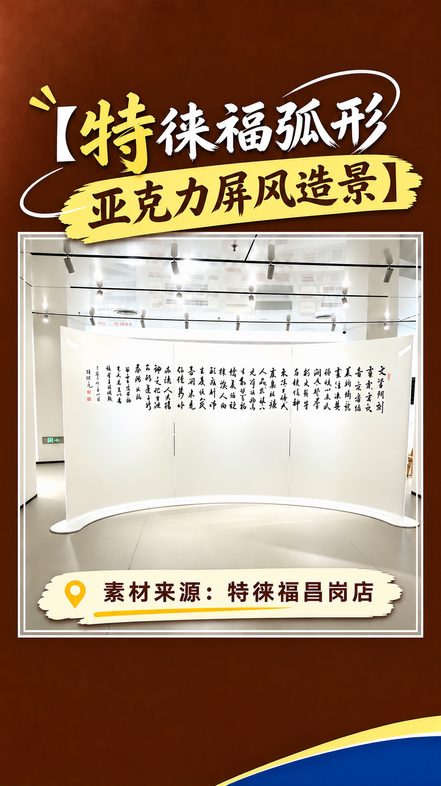

# 特徕福信息流 C 版封面

`telaifu-coverC` 是一个 Codex Skill。提供标题和一张产品原图，生成一张 **1080 × 1920** 的竖版 PNG。版式包含棕色底纹、粗笔刷标题、白色双线产品框和来源贴纸。标准相框高 **989 px**，约占整图高度的 **51.5%**。



## 安装与使用

将仓库克隆到 Codex 的个人 skills 目录。Windows PowerShell 示例：

```powershell
$codexDir = if ($env:CODEX_HOME) { $env:CODEX_HOME } else { Join-Path $env:USERPROFILE '.codex' }
$skillsDir = Join-Path $codexDir 'skills'
New-Item -ItemType Directory -Path $skillsDir -Force | Out-Null
git clone https://github.com/Valentina-Qiao/telaifu-coverC.git (Join-Path $skillsDir 'telaifu-coverC')
```

在 Codex 里说「制作特徕福信息流 C 版封面」或调用 `$telaifu-coverC`，附上标题和原照。默认来源贴纸为「素材来源：特徕福昌岗店」，其他店名可在请求中指定。

## 制作与验收

1. 用 ImageGen 参照确认稿生成独立的粗笔刷字稿，核对文案后以绿幕抠出透明 PNG。
2. 将透明字稿、原照片及来源贴纸合成。图片需要全幅保留时，用照片边缘延展填满相框。
3. 检查整张 9:16 图和约 3:4 的后台可见区，确认字稿、产品细节和来源都完整可见。

字稿生成使用 Codex 的 ImageGen。合成脚本使用 Windows 上带 Pillow 和 NumPy 的 Python，并读取系统的华文行楷和微软雅黑粗体。可使用 Codex 工作区提供的 Python，也可以在自己的 Python 环境中安装依赖：

```powershell
python -m pip install Pillow NumPy
```

参数及命令见 [SKILL.md](SKILL.md)，字形与补边方案见[制作与交付标准](references/delivery-standard.md)。
