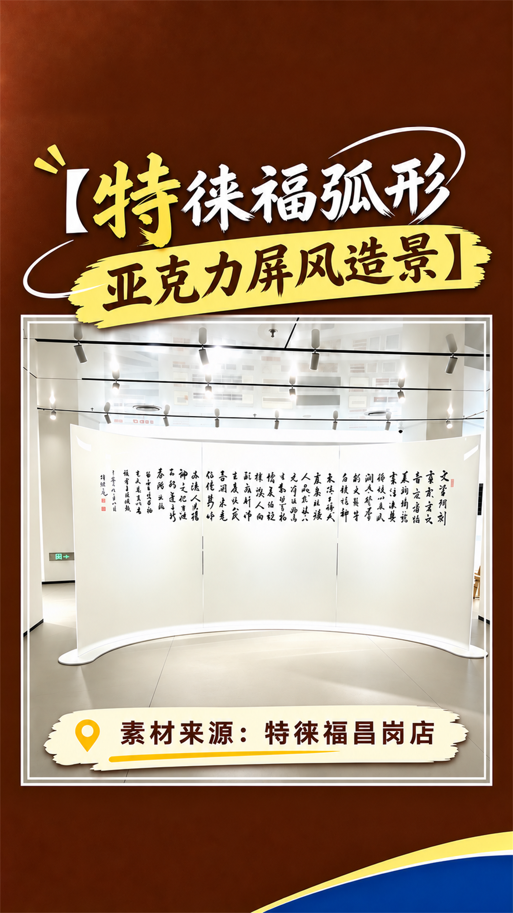

# 特徕福信息流 C 版封面

`telaifu-coverC` 是一个 Codex Skill。提供标题和一张产品原图，生成一张 **1080 × 1920** 的竖版 PNG。版式包含棕色底纹、粗笔刷标题、白色双线产品框和来源贴纸。标准主题高 **1386 px**，上下各留 **267 px**，相框高 **989 px**。

## 参考图

- [图一｜完整 9:16 封面](references/approved-cover.png)用于确定成品画布和相框比例。
- [图二｜后台裁剪验收截图](references/approved-platform-crop.png)用于核对约 3:4 可见区。



## 安装与使用

将仓库克隆到 Codex 的个人 skills 目录。Windows PowerShell 示例：

```powershell
$codexDir = if ($env:CODEX_HOME) { $env:CODEX_HOME } else { Join-Path $env:USERPROFILE '.codex' }
$skillsDir = Join-Path $codexDir 'skills'
New-Item -ItemType Directory -Path $skillsDir -Force | Out-Null
git clone https://github.com/Valentina-Qiao/telaifu-coverC.git (Join-Path $skillsDir 'telaifu-coverC')
```

在 Codex 或 WorkBuddy 里调用 `telaifu-coverC`，提供标题和原照。来源沿用确认稿字形与贴纸，按[字距样张](references/source-badge-spacing.png)把文案排为一行，冒号两侧与正文间隔一致。指定其他门店时保留原前缀字形，用微软雅黑粗体排右侧店名。安装时导入完整技能目录，以便合成脚本读取随包贴纸。

## 制作与验收

1. 用 ImageGen 参照确认稿生成独立的粗笔刷字稿，核对文案后以绿幕抠出透明 PNG。
2. 将透明字稿、原照片及来源贴纸合成。图片需要全幅保留时，用照片边缘延展填满相框。
3. 检查整张 9:16 图和约 3:4 的后台可见区。居中的 1080 × 1440 裁剪窗口上下各留 **27 px**。后台裁剪框固定且偏移时，在实际可见区居中。

字稿生成可用 Codex 的 ImageGen。脚本依赖 Pillow 和 NumPy。使用独立标题字稿和默认来源贴纸时无需系统字体，本地标题和自定义门店名分别使用 Windows 的华文行楷和微软雅黑粗体。可使用 Codex 工作区提供的 Python，也可以在自己的 Python 环境中安装依赖：

```powershell
python -m pip install Pillow NumPy
```

参数及命令见 [SKILL.md](SKILL.md)，字形与补边方案见[制作与交付标准](references/delivery-standard.md)。
