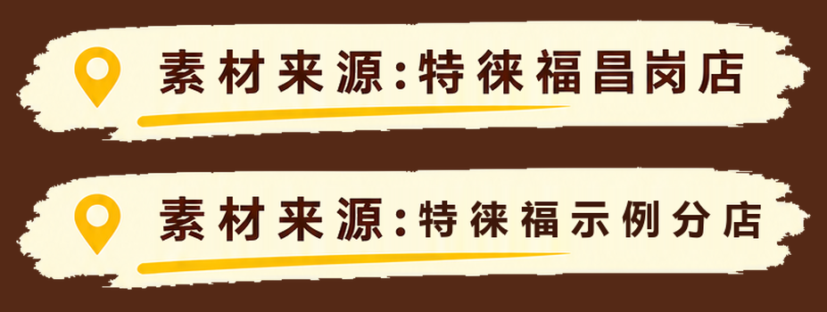

# 特徕福视频封面制作与交付标准

- [图一｜新确认的完整 9:16 封面](approved-cover.png)为 1080 × 1920 的无标注成品参考，用于确定主题边界、上下留白、相框比例和书法风格。
- [图二｜新确认的后台裁剪截图](approved-platform-crop.png)为 585 × 775 的验收截图。截图里的绿框标识主题内容。判断可见范围时看后台裁剪框。

## 固定版式

产品相框外沿约为 **994 × 989 px**，高度约占 1080 × 1920 画布的 **51.5%**，约占 3:4 裁剪窗口高度的 **69%**。从双线外框的上、下沿测量，被笔刷叠住的位置按外框延长线量取。

下表从 1080 × 1920 画布左上角起算。区间下端是下沿的坐标边界。

| 元素 | 确认样图位置 |
| --- | --- |
| 完整主题内容 | `y=267–1653 px`，总高 1386 px，约占全幅高 72.2% |
| 标题组 | `y≈267–693 px`，黄色副标题笔刷搭在相框上沿 |
| 产品图与相框 | `x≈43–1037 px`，`y≈664–1653 px` |
| 来源贴纸 | `y≈1485–1620 px`，压在相框内下方的空白处 |
| 居中 3:4 裁剪窗口 | `y=240–1680 px`，窗口高 1440 px |

## 上下留白

测量边界为标题及相关装饰、产品图相框和来源贴纸形成的主题轮廓。上留白从画布或裁剪框上沿量到主题上沿，下留白从主题下沿量到画布或裁剪框下沿。右下蓝金弧形属于背景。

| 场景 | 脚本居中基准 | 验收 |
| --- | --- | --- |
| 完整 9:16 成品 | 1080 × 1920 画布 | 上下各 **267 px**，各占画布高约 **13.9%**。查看 `group_top_px` 和 `group_bottom_px` |
| 居中 3:4 裁剪 | 1080 × 1440 检查窗口 | 上下各 **27 px**，各占窗口高约 **1.9%**。查看 `crop_margin_top_px` 和 `crop_margin_bottom_px` |
| 偏移的固定后台裁剪 | 当前截图所对应的 `crop_top` 和 `crop_height` | 在实际窗口内居中，再核对实际裁剪余量及主题是否完整 |

默认成品按 1386 px 的内容高度验收，取整容差为 1 px。字稿过宽时优先调整标题排布，再按原比例复算。实际后台界面会缩放图片，验收数值统一换算到 1080 px 宽的画布或裁剪窗口。

## 已验证的修正

### 按参考图重做标题和来源贴纸

首版的系统行楷笔画偏细，和确认稿的粗笔刷字形有明显差别。以确认稿作为字形参考，用 ImageGen 独立生成标题层。重点还原方折笔画、飞白收笔、放大的奶金色「特」字、微微上扬的黄色副标题笔刷，以及白色弧线。字稿用纯绿背景生成，经 `key_green.py` 抠为透明 PNG，再以 `headline_image` 合成。逐字检查主副标题，用诊断图查看绿边和笔画断裂。调构图时复用已核对的字稿。

来源沿用确认稿提取的[贴纸](../assets/approved-source-badge.png)的字形、定位图标与下划线，文字按下方最新字距规范重新排列。

### 素材来源字距

| 验收项 | 交付标准 |
| --- | --- |
| 文案与字形 | 「素材来源：门店名」使用一行排版。默认保留参考稿的全部字形。自定义门店保留前缀原字形，店名用微软雅黑粗体，字高贴近前缀。 |
| 字距 | 从相邻字形的墨迹边缘量。前缀、冒号两侧与店名共用同一字距。常规字距在 1080 px 宽成品中以约 **16 px** 为目标，样张实测 **15–17 px**。 |
| 长短店名 | 短店名沿用常规字距。长店名优先缩字号，必要时同时收紧整行字距，保留相近的冒号左右间距和右端安全边距。 |
| 交付检查 | 在全图和 3:4 预览中查看整行顺畅、定位图标和下划线清楚，冒号后空隙与正文间距接近。原封面参考用于整体排版，来源文字的字距以本节样张为准。 |

### 用照片边缘填充相框空白

横图全幅入框时，旧的纯色填充会在照片上下形成明显色块。现在先按副标题笔刷下沿和来源贴纸上沿确定安全区域，再用 `contain` 将原图等比放入。上、下、左、右的余量由贴近该位置的照片边缘延展。原图主体、标牌和小字保留在安全区域内，外框仍按 989 px 高度渲染。

双标牌横图已用这一流程复核。验收时看整图与 3:4 预览，检查标牌和小字、接缝和延展方向。延展过长且出现明显拉丝时，先调 `focus` 尝试等比铺满，或换用同一原图中留有更多背景的取景。

## 复调方法

| 遇到的问题 | 调整方法 |
| --- | --- |
| 字形与确认稿不一致 | 按上面的字稿流程重做标题图层，保留已核对的文案。 |
| 标题偏小或拥挤 | 对照确认稿检查两行所占面积。保留用户指定的分行。未指定时，可在自然语义处分配长短，重新检查笔画、两行之间及两端的留白。 |
| 调整标题后笔刷变窄、被压住或遮挡产品 | 一起检查主标题、黄色副标题笔刷和相框上沿。笔刷两端应可辨，搭在照片上方空白处，留出产品顶部和标识。优先微调标题及笔刷的空间，保留相框高度。 |
| 主体、底座或店招被裁 | 保留已核对的标题、来源和原图，先调 `focus`。需要全幅时按上面的 `contain` 流程检查取景和补边。 |
| 后台裁剪线贴住标题或贴纸 | 以实际截图校准裁剪框，检查相框下沿和卡片角标的位置。空间不足时优先利用背景和照片空白处，必要时整体略微等比缩小。交付时说明裁剪导致的居中偏移或缩放。 |

## 交付标准

| 验收项 | 通过条件 |
| --- | --- |
| 成品 | 一张 1080 × 1920 的 9:16 PNG。裁剪检查图单独保留，成品画面干净。 |
| 标题和装饰 | 主副标题逐字正确，重点核对「徕」、复杂字、数字及字母大小写。笔画完整，黄色副标题笔刷可辨，白色双线相框和右下蓝金底纹可对照确认稿。 |
| 产品图和来源 | 使用一张用户原图等比合成，主体、关键细节和底座完整。照片和边缘延展填满相框。奶黄贴纸覆盖相框内下方空白，定位图标和下划线可辨。默认贴纸直接使用确认稿图层，其他店名在原贴纸右侧单行排入。 |
| 留白和后台裁剪 | 按 `center_scope` 核对对应范围，上下留白差不超过 1 px。按裁剪检查图确认三项内容及相框边缘可见，有真实后台预览时复核裁剪线和卡片角标。 |
